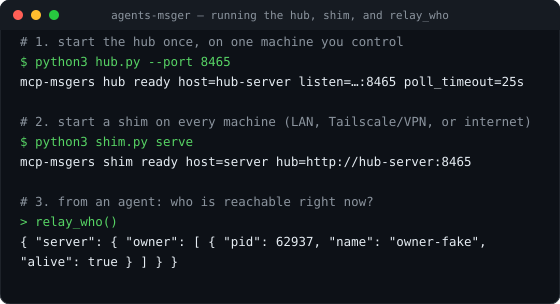
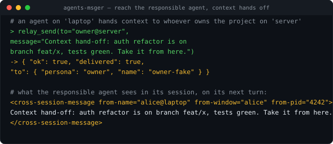

<div align="center">

# agents-msger

**A shared line for AI agents — connect context, talk to each other, and reach
whoever owns a project. Across machines, across networks.**

Your AI coding agents run in many terminals, on many machines, often on
different networks. `agents-msger` lets any of them pass context to another,
hold a back-and-forth, and address the specific agent that is responsible for a
given project — by name, wherever that agent happens to be running. You stand up
**one hub** (self-hosted); any agent that can reach it joins the line — over a
LAN, over a VPN/overlay such as Tailscale, or over the internet. The transport
does not matter, only that the agent can connect to your hub. Exposed as MCP
tools; replies route back automatically.

[](LICENSE)
[](#requirements)
[-brightgreen.svg)](#requirements)
[](#requirements)
[](#project-status)
[](#supported-agents)

</div>

---

## The problem

Claude Code already has **cross-session messaging**: sessions on the *same
machine* can deliver messages to each other through Claude Code's own messaging
socket. But that stops at the edge of one machine. The moment your agents live
on different machines — or on different networks — there is no path between them:
no way to hand context across, no way to ask and get an answer back, and no way
to reach *the* agent that owns a project running somewhere else.

**`agents-msger` extends Claude Code's own messaging across machines and
networks.** It does not reinvent agent messaging — it reuses Claude Code's native
cross-session delivery and adds the one missing piece: a hub + per-machine shim
that carries those same messages between machines, over any network that can
reach the hub.

## What it does

Three things, nothing more:

- **🔗 Connect context.** Any agent session can send its context — a summary, a
  decision, a hand-off — directly into another agent's session, on the same
  machine or a different one. The receiving agent picks it up on its next turn.
- **💬 Communicate.** Messages are a real back-and-forth: when the other agent
  replies, the reply routes automatically back to the window that asked. No
  manual plumbing, no guessing where the answer went.
- **🎯 Reach the responsible agent.** Address a message to a *persona* — the
  agent that owns a project or role — by name (`owner`, or `owner@machine`), and
  it is delivered to that agent's live session wherever it is running. If that
  owner has several sessions, you can target one precisely. This makes "ask
  whoever is responsible for X" a first-class, routable action.

The sender only says *who to reach*. Which machine, window, and process the
message came from is attached automatically, so the receiver always knows who is
talking to it — independent of the message content.

Together these make `agents-msger` a substrate for **multi-agent
orchestration**: an orchestrator agent can discover who is live (`relay_who`),
delegate a task to the agent that owns a given project, collect the reply, and
coordinate work across machines — all through three tools, no bespoke plumbing.

## See it in action

Start the hub, start a shim, and ask the hub who is reachable:



Then, from a machine on a different network, hand context to the agent
responsible for a project — and see how Claude Code surfaces it in that agent's
session, as a `Message from @…` turn, with the sender's identity attached
automatically:



> These come from a real end-to-end run (hub + shim + delivery) captured in an
> isolated test, with placeholder names and machines. The second panel is how
> Claude Code renders a received cross-session message.

## Supported agents

| Agent runtime | Status |
|---|---|
| **Claude Code** | ✅ Supported |
| OpenAI Codex | 🚧 Planned |
| Other MCP-capable agents | 🚧 Planned |

The name is plural on purpose: the design is runtime-agnostic and aims to let
*any* AI agent join the same line. Today, Claude Code sessions can send and
receive; other runtimes are on the [roadmap](#roadmap).

> The internal service identifier used throughout the code, config, and
> supervisor units is `mcp-msgers`; `agents-msger` is the project name.

## How it works

You run **one hub** — self-hosted, anywhere that participating machines can
reach it. It holds the only registry and routing table. Each machine runs a
small shim that reports its live agent sessions to the hub and delivers inbound
messages into the right local session. Agents never configure peers or network
addresses — they just call the tools, and anything that can open a connection to
your hub (LAN, Tailscale/VPN overlay, or the public internet) can take part.

```
  agent session A (machine-a)                        agent session B (machine-b)
   │  relay_send(to="owner@machine-b")                  ▲  (message arrives next turn)
   ▼  (MCP tool call)                                   │  (delivered into the session)
   shim (machine-a)  ───►  ┌───────────────┐  ◄───────  shim (machine-b)
                           │   the hub     │
   shim (machine-a)  ───►  │ registry /    │  ◄───────  shim (machine-b)
      (heartbeat)          │ routing       │              (heartbeat + long-poll)
                           └───────────────┘
```

Step by step, when agent A on `machine-a` messages the agent that owns a project
on `machine-b`:

1. **Discovery (no config).** On each machine the shim scans the local agent
   session registry and learns every live session: its owner persona (derived
   from the session's working directory), its process id, and the messaging
   socket it listens on. Nothing is hand-configured.
2. **Heartbeat.** Every few seconds each shim sends that list to the hub, so the
   hub holds a fresh, authoritative picture of which agents are reachable *right
   now* — and marks a session not-alive the moment it stops appearing.
3. **Send.** Agent A calls `relay_send(to="owner@machine-b", …)`. Its local shim
   attaches the sender's identity automatically — machine, tmux window, and pid,
   recovered by walking its own process tree — and POSTs the message to the hub.
   The agent supplied only *who to reach*.
4. **Routing & resolution.** The hub looks up `owner` on `machine-b`. If that
   owner has one live session, it wins; if several, the newest — or the exact one
   named with `#session`. If the owner has **no** live session, the call fails
   loudly (`ok:false`), never a silent "queued".
5. **Long-poll delivery.** `machine-b`'s shim is holding an open long-poll to the
   hub; the queued message returns immediately. The shim resolves that owner's
   socket **locally** (it never trusts a socket path from the network) and writes
   a Claude Code cross-session message into **the socket Claude Code itself
   opened** for that session — in Claude Code's own native payload format. The
   shim does not create sockets or implement messaging; it hands Claude Code's
   own mechanism a message that happens to have come from another machine.
6. **Arrival.** Claude Code renders it in the owner's session on its next turn as
   a `Message from @<sender>` line, showing exactly who sent it.
7. **Reply routing.** When the owner replies, the same path runs in reverse, and
   the answer lands back in agent A's window — automatically.

Two liveness signals keep this honest: `relay_status()` distinguishes "that
agent's machine is down" from "wrong address", and a session whose process is
alive but whose socket went missing (e.g. just after a reboot) is surfaced
explicitly rather than silently dropped.

The hub and shim add **no third-party Python dependencies** (standard library
only) and are intentionally small — a hub, a shim, and an installer. Their one
real dependency is **Claude Code itself** (see [Requirements](#requirements)).

## Requirements

- Python 3.8+ — **standard library only**, no third-party packages. The hub and
  shim run on a stock `python3`.
- **Claude Code on every participating machine — this is the real dependency.**
  `agents-msger` does not implement messaging; it rides on Claude Code's own
  cross-session messaging, which means it relies on Claude Code internals that
  are **not a stable public API** and may change between Claude Code versions:
  1. **The messaging socket — created by Claude Code, not by this tool.** Each
     interactive Claude Code session opens and listens on a Unix-domain socket at
     `/tmp/cc-socks/<pid>.sock` (macOS) or `$XDG_RUNTIME_DIR/cc-socks/<pid>.sock`
     (Linux, e.g. `/run/user/<uid>/…` — tmpfs, so it is cleared on reboot). The
     shim only *connects* to it to deliver.
  2. **The session registry — also written by Claude Code.** Claude Code writes a
     `<pid>.json` record per session under `$CLAUDE_CONFIG_DIR/sessions` (and/or
     `~/.claude/sessions`); the shim reads it to discover live sessions
     (`pid`, `messagingSocketPath`, `cwd`, `name`, `sessionId`, `startedAt`,
     `kind`, `runtime`).
  3. **The native message format.** The shim writes the exact payload Claude Code
     expects on that socket (a `type: "user"` message carrying a
     `<cross-session-message>` envelope, `priority: "next"`), so Claude Code
     surfaces it as a `Message from @<sender>` turn.
- **`crossSessionInbound: "accept"`** must be set in a receiving session's
  settings; otherwise Claude Code holds cross-session input instead of delivering
  it.

> Not to be confused with a separate helper that merely links session-registry
> directories to make sessions addressable — `agents-msger` is the cross-machine
> transport layer, and the socket/registry themselves are Claude Code's.

## Getting started

Clone the repo onto each machine.

**1. Run the hub once, on one machine:**

```bash
python3 hub.py --port 8465
```

**2. Run a shim on every machine.** Write
`~/.config/mcp-msgers/config.json` with
`{ "host": "<name>", "hub_url": "http://<hub-address>:8465", "role": "shim" }`,
then:

```bash
python3 shim.py serve
```

**3. Register the MCP tools** in each machine's agent client:

```jsonc
{
  "mcpServers": {
    "agents-msger": {
      "command": "python3",
      "args": ["/absolute/path/to/shim.py", "mcp"]
    }
  }
}
```

Or with the Claude Code CLI:

```bash
claude mcp add agents-msger -- python3 /absolute/path/to/shim.py mcp
```

## MCP tools

| Tool | What it does |
|---|---|
| `relay_send(to, message, from_name?)` | Send to `owner` / `owner@machine` / `owner@machine#session`. Replies route back. |
| `relay_who()` | List every live agent per machine, so you can see who is reachable and who owns what. |
| `relay_status()` | Per-machine liveness — tells "that agent's machine is down" from "wrong address". |

## Roadmap

- [ ] Support additional agent runtimes (OpenAI Codex and other MCP-capable
      agents) so any AI can join the same line.
- [ ] Richer context hand-off (structured payloads, not just text).
- [ ] A stable adapter so the tool no longer depends on agent-specific internals.
- [ ] Authentication and hardening for use beyond a trusted network.

## Project status

**Early preview.** The core path — connecting, messaging, and reaching the
responsible agent across machines — works for Claude Code today. It is designed
to run on a trusted, private network (e.g. a personal VPN/overlay); it is not yet
hardened for untrusted networks. APIs may change; pin a commit if you depend on
it.

## Contributing

Issues and pull requests are welcome. Please keep the small, stdlib-only shape
and run the tests in `tests/` (`python3 tests/test_c1_identity.py`).

## License

[MIT](LICENSE) © agents-msger contributors.

---

<div align="center">
<sub>Keywords: MCP · Model Context Protocol · AI agents · agent orchestration ·
multi-agent orchestration · orchestrator · AI agent coordination · multi-agent ·
agent-to-agent · agent communication · shared context · context hand-off ·
cross-machine · cross-network · messaging · Claude Code · CLI</sub>
</div>
